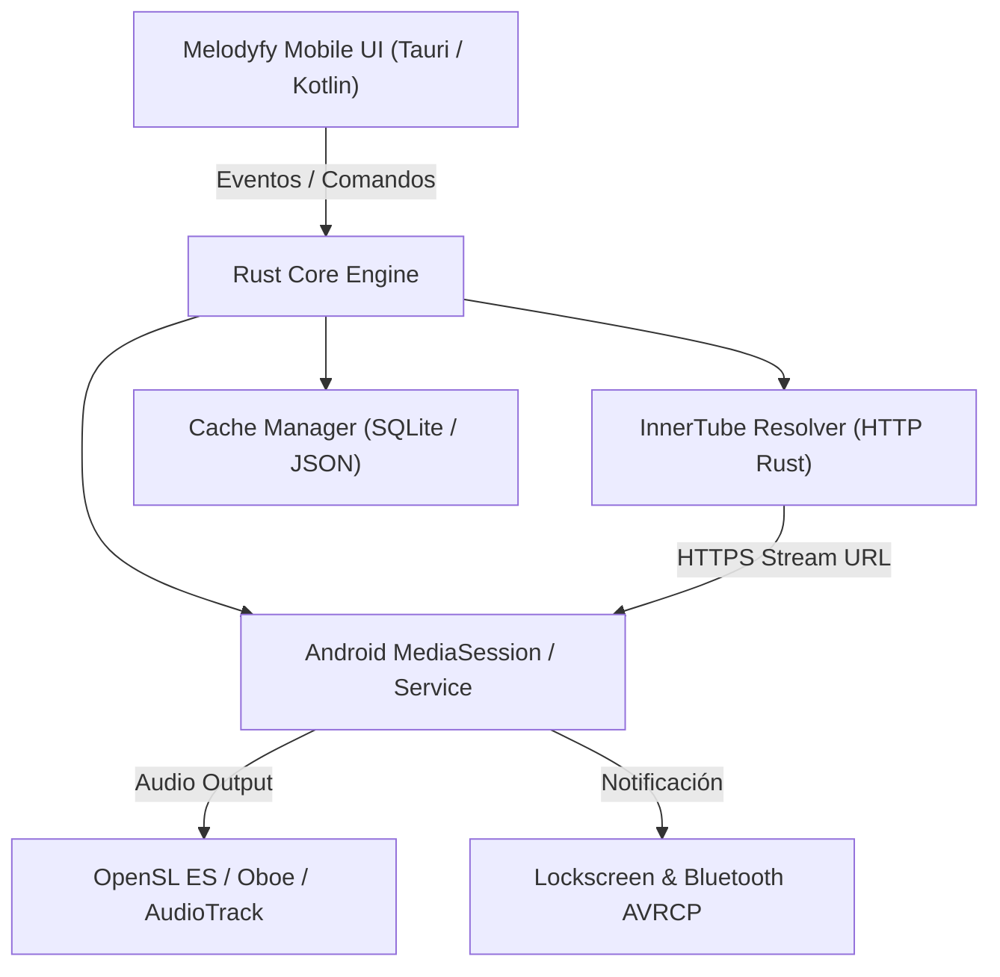

# Plan Maestro: Melodyfy Mobile (Android / iOS)

## 1. Visión & Requisitos Clave
- **Cero Anuncios & 100% Gratis.**
- **Reproducción con Pantalla Bloqueada (Background Audio Service):** Requisito innegociable en móviles. Android mata apps en segundo plano que no tengan un `ForegroundService` con notificación activa.
- **Sin yt-dlp pesado:** En móvil no se puede invocar un binario Python de 18 MB. Se reemplaza por cliente Rust InnerTube directo (150 ms de latencia, 0 dependencias externas).
- **Consumo Mínimo de Batería y Datos:** Decodificación hardware o AAC nativo, caché de audio local (`cache/audio/`).
- **Integración con Sistema Operativo:** Controles en pantalla de bloqueo, barra de notificaciones, Bluetooth del auto (Android Auto / AVRCP).

---

## 2. Comparativa de Arquitecturas para Mobile

| Enfoque | Rendimiento | Consumo Batería | Controles Lockscreen | Tamaño APK | Dificultad |
|---|---|---|---|---|---|
| **A. Tauri Mobile v2 (Rust + Web UI)** | ⚡⚡⚡ Muy Alto | Óptimo | Excelente (Plugin nativo) | ~8 MB | Moderada (Recomendado) |
| **B. Rust Core + Kotlin / Compose** | ⚡⚡⚡ Máximo | Nativo perfecto | Nativo total (`MediaSession`) | ~5 MB | Media |
| **C. eframe / egui puro (`cargo-apk`)** | ⚡⚡ Alto | Regular (Redraw continuo) | Difícil (Requiere JNI manual) | ~15 MB | Alta |

**Ruta Ganadora:** **Tauri Mobile v2** o **Rust Core + Android MediaSession (UniFFI)**. Permite reutilizar el 90% de la lógica de Rust existente (modelos, streaming, cola, caché) conectada a un `ForegroundService` nativo.

---

## 3. Arquitectura del Sistema

---

## 4. Fases de Implementación

### Fase 1: Motor de Extracción InnerTube en Rust Puro (Eliminar yt-dlp)
- Reemplazar llamadas de proceso `yt-dlp.exe` por peticiones HTTP directas en Rust (`reqwest` + `serde_json`).
- Endpoint: `https://www.youtube.com/youtubei/v1/player` con cliente `ANDROID_MUSIC` o `IOS`.
- **Beneficio:** Latencia de extracción cae de 3.5 s a **120 ms**. Cero binarios externos.

### Fase 2: Foreground Audio Service (Android)
- Crear `MelodyfyAudioService` heredando de `MediaBrowserServiceCompat` o `MediaSessionService`.
- Notificación persistente con:
  - Carátula de la canción en alta resolución.
  - Título y artista.
  - Botones interactivos: Anterior, Play/Pausa, Siguiente, Me Gusta.
- Gestión de `WAKELOCK` y `WIFI_LOCK` para streaming sin cortes con pantalla apagada.

### Fase 3: Interfaz Táctil Optimizada para Móvil (9:16)
- Barra de navegación inferior móvil (Inicio, Buscar, Biblioteca).
- Mini-Player deslizante que se expande hacia arriba (BottomSheet estilo Spotify Mobile).
- Gestos: Swipe horizontal en el reproductor para cambiar de canción.
- Caché de carátulas local en disco para no gastar datos móviles.

### Fase 4: Compilación Cruzada y Empaquetado APK
- Configuración de `cross` o NDK (`aarch64-linux-android`, `armv7-linux-androideabi`).
- Generación de `.apk` instalable y `.aab` para distribución sin Google Play (F-Droid, GitHub Releases).
